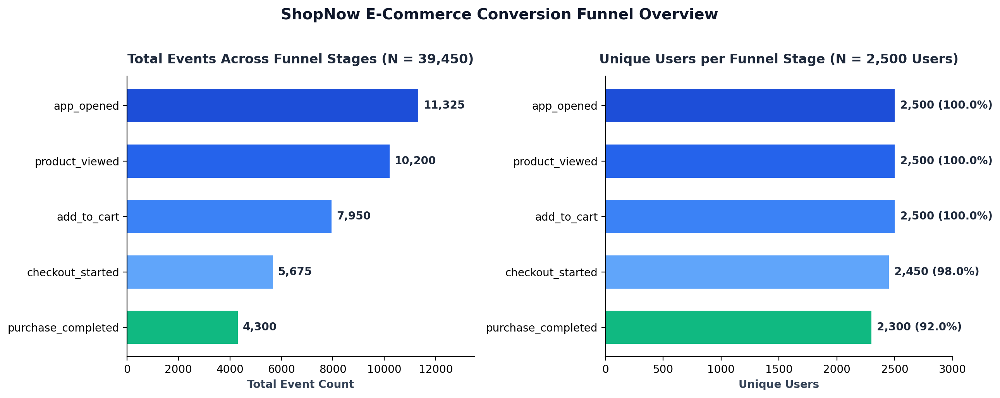
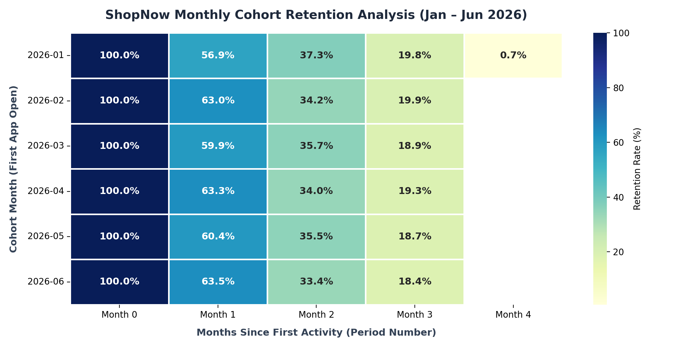

# ShopNow E-Commerce Product Analytics (SQL Server & Python)

End-to-end product analytics project examining user acquisition, session navigation paths, multi-stage conversion funnels, and monthly cohort retention across **2,500 users**, **39,450 behavioral events**, and **9,075 transaction lines** (**178,115,910.00** total revenue).

## Project Overview

This repository combines **Microsoft SQL Server (T-SQL)** database engineering and window-function analytics with **Python (Pandas, Seaborn, Matplotlib)** cohort retention modeling to evaluate product performance for **ShopNow**, a multi-category e-commerce platform operating across Egypt, Saudi Arabia, and the UAE.

### Core Business Questions Answered
1. **Channel & Revenue Attribution**: Which acquisition channels (`Facebook`, `Google`, `Organic`, `TikTok`) drive the highest transaction volume and average order value (AOV)?
2. **User Journey & Session Velocity**: What paths do users take inside a session, and how many seconds elapse between sequential steps (`LEAD`, `LAG`, `DATEDIFF`)?
3. **Conversion Funnel Drop-Off**: Where do users drop off between opening the app (`app_opened`) and completing a purchase (`purchase_completed`), overall and segmented by device (`Android`, `iOS`, `Desktop`)?
4. **Monthly Cohort Retention**: How well does each monthly user cohort (`2026-01` through `2026-06`) retain active engagement across subsequent months?

## Repository Structure

```text
ShopNow-Product-Analytics/
├── README.md                                  # Project documentation, insights, and execution guide
├── requirements.txt                           # Python dependencies for cohort analysis & plotting
├── .gitignore                                 # Standard Git ignore rules for Python & Jupyter
├── LICENSE                                    # MIT License
├── assets/
│   ├── cohort_retention_heatmap.png           # Monthly cohort retention heatmap (Seaborn)
│   └── funnel_conversion_overview.png         # E-commerce funnel events & unique user breakdown
├── data/
│   └── events.xlsx                            # Exported behavioral event log (39,450 rows, 7 columns)
├── notebooks/
│   └── product_analysis.ipynb                 # Python Jupyter Notebook for Monthly Cohort Analysis
└── sql/
    ├── 01_Database_Schema_and_Seed.sql        # Deterministic DDL + 2.5K users, 20 products, 39.45K events, 9.07K transactions
    ├── 02_View_Data.sql                       # Quick exploratory table inspection queries
    └── 03_Product_Analytics_DQL.sql           # Analytical SQL queries (Window Functions, CTEs, Funnel Drop-off)
```

## Database Schema & Key Metrics

The deterministic SQL Server build script (`sql/01_Database_Schema_and_Seed.sql`) creates the `ShopNow_ProductAnalytics` database with four relational tables:

| Table Name | Primary Key | Row Count | Description & Key Attributes |
| :--- | :--- | :--- | :--- |
| `dbo.Users` | `user_id` | 2,500 | User signups spread across 180 days (`2026-01-01` to `2026-06-29`), segmented by `source` (`Facebook`, `Google`, `Organic`, `TikTok`), `country` (`Egypt`, `Saudi Arabia`, `UAE`), and `device_type` (`Android`, `iOS`, `Desktop`). |
| `dbo.Products` | `product_id` | 20 | Catalog across `Electronics`, `Accessories`, `Wearables`, and `Fashion` with `unit_price` ranging from `450.00` to `30,000.00`. |
| `dbo.Events` | `event_id` | 39,450 | Timestamped user actions across Day-0 signup sessions and 8 returning-user retention milestones (Days `1`, `3`, `7`, `14`, `30`, `45`, `60`, and `90`). |
| `dbo.Transactions` | `transaction_id` | 9,075 | Multi-item basket line items tied to `purchase_completed` events (`4,300` distinct orders), with persisted `revenue = quantity * unit_price - discount`. |

### Headline KPIs (Validated in SQL)
* **Total Users**: `2,500` (`834` Android, `833` Desktop, `833` iOS)
* **Total Behavioral Events**: `39,450`
* **Total Completed Orders**: `4,300` (`9,075` transaction line items)
* **Total Net Revenue**: `178,115,910.00`
* **Average Order Value (AOV)**: `41,422.30`
* **Average Line-Item Revenue**: `19,627.10`

## Conversion Funnel Analysis (`sql/03_Product_Analytics_DQL.sql`)



Using Common Table Expressions (CTEs) and window functions (`LAG`, `FIRST_VALUE`), the SQL analysis tracks unique user progression and event volume across the 5-stage purchase funnel:

| Funnel Stage | Event Name | Total Events | Unique Users | Step-to-Step Drop-Off | Overall User Conversion |
| :--- | :--- | :--- | :--- | :--- | :--- |
| **1. Awareness** | `app_opened` | 11,325 | 2,500 | — | 100.0% |
| **2. Discovery** | `product_viewed` | 10,200 | 2,500 | 0 (0.0%) | 100.0% |
| **3. Intent** | `add_to_cart` | 7,950 | 2,500 | 0 (0.0%) | 100.0% |
| **4. Checkout** | `checkout_started` | 5,675 | 2,450 | 50 (2.0%) | 98.0% |
| **5. Conversion** | `purchase_completed` | 4,300 | 2,300 | 150 (6.1%) | 92.0% |

### SQL Analytical Highlights
* **Cumulative & Comparative Spending**: Computes running transaction totals and compares each transaction's revenue against the user's historical average (`AVG(revenue) OVER (PARTITION BY user_id)`).
* **Session Pathing & Dwell Time**: Tracks each user's next step within a session using `LEAD(event_name, 1, 'End Of Session') OVER (PARTITION BY session_id ORDER BY event_time)` and measures step duration in seconds via `DATEDIFF(SECOND, LAG(event_time) OVER (...), event_time)`.
* **Order Recency Ranking**: Ranks user sessions and product purchases from newest to oldest using `ROW_NUMBER() OVER (PARTITION BY user_id ORDER BY event_time DESC)`.
* **Device-Segmented Funnel**: Partitions funnel stages by `device_type` (`Android`, `iOS`, `Desktop`) to isolate platform-specific drop-off rates.

## Monthly Cohort Retention Analysis (`notebooks/product_analysis.ipynb`)



Using Python (`pandas`, `seaborn`, `matplotlib`), the notebook ingests `data/events.xlsx` (`39,450` events), identifies each user's initial `app_opened` timestamp to assign a `cohort_month` (`2026-01` through `2026-06`), and tracks active user retention across subsequent calendar months (`period_number` `0` to `4`):

| Cohort Month | Cohort Size (Month 0) | Month 0 (%) | Month 1 (%) | Month 2 (%) | Month 3 (%) | Month 4 (%) |
| :--- | :--- | :--- | :--- | :--- | :--- | :--- |
| **2026-01** | 434 | 100.0% | 56.91% | 37.33% | 19.82% | 0.69% |
| **2026-02** | 392 | 100.0% | 63.01% | 34.18% | 19.90% | — |
| **2026-03** | 434 | 100.0% | 59.91% | 35.71% | 18.89% | — |
| **2026-04** | 420 | 100.0% | 63.33% | 34.05% | 19.29% | — |
| **2026-05** | 434 | 100.0% | 60.37% | 35.48% | 18.66% | — |
| **2026-06** | 386 | 100.0% | 63.47% | 33.42% | 18.39% | — |

### Key Retention Takeaways
* **Strong Month-1 Engagement**: Across all six monthly cohorts, **56.9% to 63.5%** of users return in the calendar month following their initial signup.
* **Consistent Mid-Term Retention**: Approximately **33.4% to 37.3%** of users remain active in Month 2, tapering to **18.4% to 19.9%** by Month 3 (reflecting the 90-day lifecycle milestone window).

## How to Run Locally

### 1. Clone the Repository
```bash
git clone https://github.com/hadyam/ShopNow-Product-Analytics.git
cd ShopNow-Product-Analytics
```

### 2. Run the SQL Server Database & Queries
1. Open **SQL Server Management Studio (SSMS)**.
2. Open `sql/01_Database_Schema_and_Seed.sql` and press **F5** to build and validate the `ShopNow_ProductAnalytics` database.
3. Run `sql/03_Product_Analytics_DQL.sql` to execute the funnel, session-path, and revenue window-function analyses.

### 3. Run the Python Cohort Analysis Notebook
```bash
pip install -r requirements.txt
jupyter notebook notebooks/product_analysis.ipynb
```

## Author

* **Hady Amr** — Data Analyst & Accountant
* **GitHub**: [@hadyam](https://github.com/hadyam)
